> **Note on 2.0:** the interface was reorganised: every effect group starts with a switch row, animators show their properties on demand, and there is a second plugin, *Text+ Fill*. Compositions from 1.x open with the matching settings, but please check them before a show.

<p align="center"></p>

# Text+

**A text source for Resolume Arena and Avenue that does what the built-in Text Block and Text Animator can't.**

Text+ renders type through a signed distance field. Every effect — outlines, glow, shadow, plates — is computed from the exact distance to the shape's edge. So an outline **grows outward only** and never eats into the letters, thick outlines of neighbouring letters **merge into one clean contour**, and everything stays **crisp at any size**. On top of that come **3D** (tilt and extrusion with bevel and light), **fill patterns** and one-click **looks**, text on a **path**, four stackable **animators**, plates for lower thirds, clocks and countdowns, live values from **OSC**, tickers and rolls, slides from text or CSV files, individually styled lines — and **Text+ Fill**, an effect that fills the text with the clip it sits on.

[**Download**](https://github.com/floriandobler/text-plus/releases/latest) · Resolume Arena / Avenue 7 · FFGL 2 · macOS (Apple Silicon + Intel) · Windows x64 (new, not yet tested in Resolume) · MIT licence

---

## Why

Resolume's own text sources grow outlines in both directions, so a thick outline eats the letter ([forum thread](https://resolume.com/forum/viewtopic.php?t=22864)). Overlapping letters get visible seams, alignment and anchors behave unexpectedly, and animation is limited to a few presets. Text+ is built around a different rendering model to fix exactly that:

<p align="center"></p>

## Features

**Simple stays simple.** Out of the box Text+ shows 29 rows (1.1: 52). Every effect group — Outline, Shadow, Glow, 3D, Path — starts with one switch row; its settings appear when you switch it on. An animator shows *Preset* and *Mode* and adds the properties you need with *+ Property*. Animators 2–4 appear one after another. *Look* sets up a complete style in one click, and everything stays editable afterwards.

<p align="center">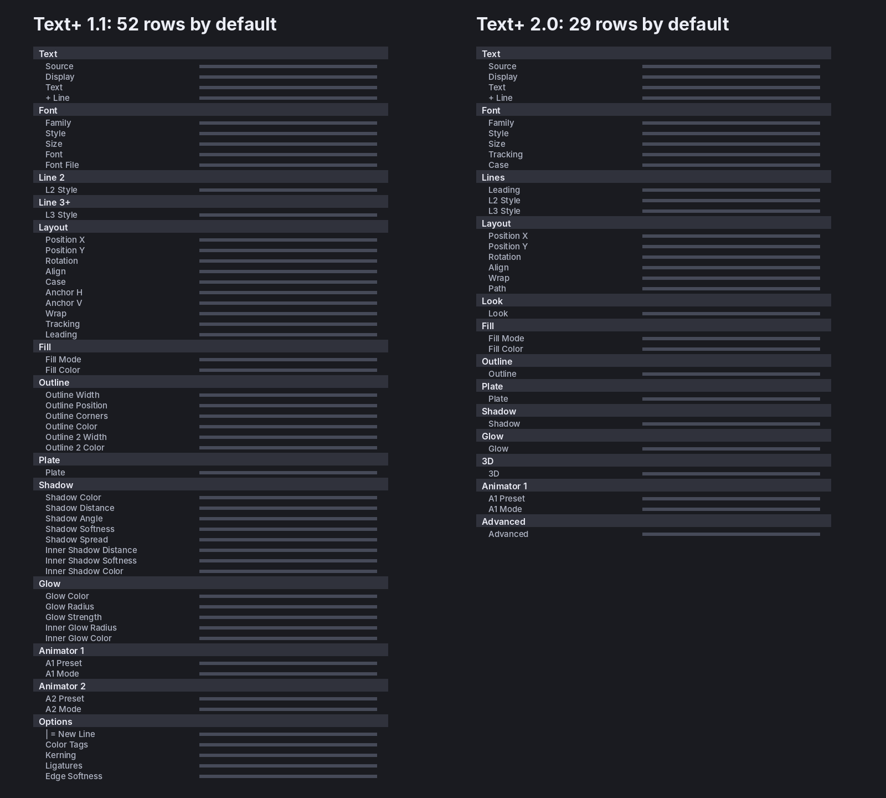</p>

**Typography**
- Any installed font (Family / Style menus, or type a name such as `din bold`), or load a `.ttf` / `.otf` / `.ttc` file directly. Variable fonts appear with their named styles.
- Real shaping with HarfBuzz: kerning, ligatures, accents, non-Latin scripts.
- **Font fallback**: characters the font doesn't have come from the font the operating system would use (CoreText on macOS, DirectWrite on Windows). Emoji come from the built-in monochrome Noto Emoji, so they get outlines and glow like text.
- Tracking, leading, left / centre / right / justified alignment, anchor independent of alignment, wrapping in a box with auto-fit (or **Fit Each Line**: every line scaled to the box width), **case** (`Tt` / `TT` / `tt`).
- **OpenType features** such as `ss01, tnum, smcp` in *Advanced*.
- **Text on a path**: an arc (rainbow or smile), a ring around the anchor, or a wave. *Path Offset* moves the text along it — ramp it and the text runs around the circle seamlessly.

**Look**
- **Looks**: Clean, Outline, Hollow, Sticker, Comic, Neon, LED Sign, Gradient Glow, Stripes, Lower Third, News Bar, Chrome 3D, Retro 3D — a starting point, not a lock.
- Fill: solid, gradient across the block or across the characters, **patterns** (stripes, halftone, checker, noise, LED dots — scale, angle and an animatable offset) or **alternating colours** per character, word or line. Fill alpha 0 gives hollow text.
- Two outline bands (outside, centred or inside), round or sharp corners.
- Drop shadow, **inner shadow** (same light direction), glow and **inner glow** — no blur passes, no halo artefacts.
- **Plates** behind the block or behind every line: padding, corner radius, slant, border, equal or box width. Overlapping line plates melt into one shape, and the drop shadow is cast by plates and text together.
- Inline colours: `{#ff4d6d}word{/}`.

<p align="center">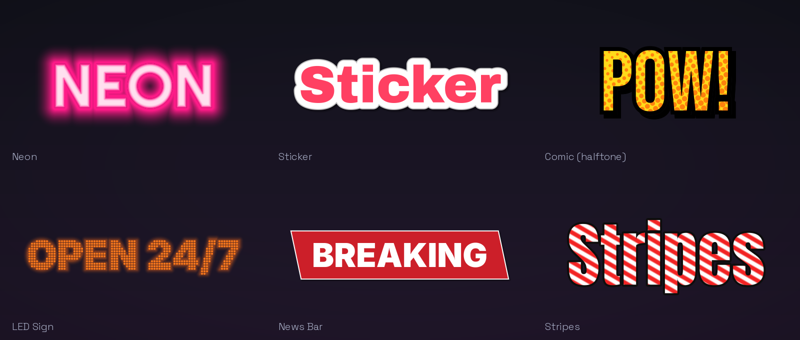</p>

**3D**
- *Tilt*: the finished picture — outlines, plates, glow — as a plane in space, with perspective.
- *Extrude*: real depth with a rounded **bevel**, its own side colour, a light (angle, height), shading and gloss. Plates, shadow and glow stay on the front.
- Tilt, perspective and light are sliders, so you animate them like anything else.

<p align="center">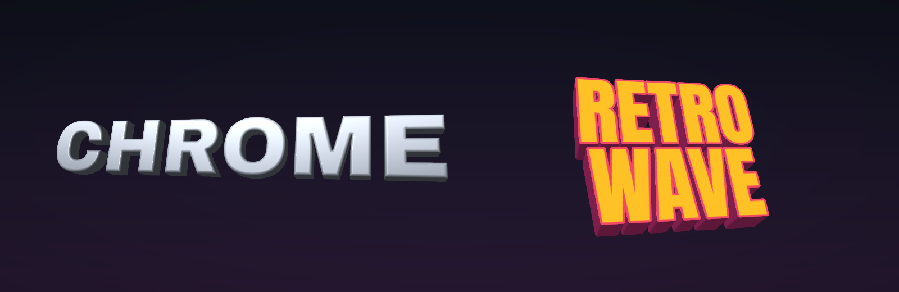</p>
<p align="center">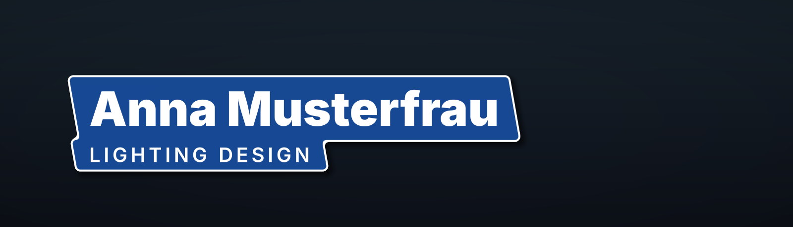</p>

**Line styles** — perfect for lower thirds
- *Line 2* and *Line 3+* can each have their own weight or font, size, colour, tracking and spacing. Outlines, glow and animation stay shared, so contours still merge.

**Content** — *Source* says where the text comes from, *Display* how it is shown
- **Input**: Resolume's text fields are single-line, so Text+ adds up to nine more fields (*+ Line*) and treats `|` as a line break.
- **File**: text files that reload as soon as you save them, and **CSV**: every row is a slide, every cell a line. Delimiter and encoding (UTF-8 or Excel's Windows-1252) are detected.
- **CSV row templates**: `{Name} · {Role}` (column names from the header row) or `{1} · {2}` builds each slide from the columns you choose; `|` breaks the line.
- **Clock & Timer**: clock, countdown to a time of day **or to a date** (`2026-12-31 23:59`, shown as `3d 04:12:09`), countdown, stopwatch, or a counter you animate like any slider. The text fields are the template: `Doors open in {timer}`, `{time} · {date}`.
- **Placeholders** in any text: `{time} {date} {weekday} {day} {month} {year}`, `{slide}` / `{slides}`, `{bpm}`, and **`{osc:/address}`** — the last value sent to that OSC address (set the *OSC Port* in *Advanced*). Scores, names from a show controller, sensor values: no extra software needed.
- **Slides** (per line, per block or **per word**): the *Slide* slider is a 0–1 position split evenly across all slides — BPM-sync it and it steps through every slide and wraps around. *Next / Previous* (and Resolume's −/+) step one slide. *Slide Order* can **shuffle** (a fixed random order, the same every show), and *Replay: Out, then In* plays the out-animation of the old slide before the new one comes in.
- **Ticker**: an endless horizontal crawl at a constant speed in px/s, with a separator and soft edges. **Roll**: a vertical roll, once or looping, for credits.

<p align="center">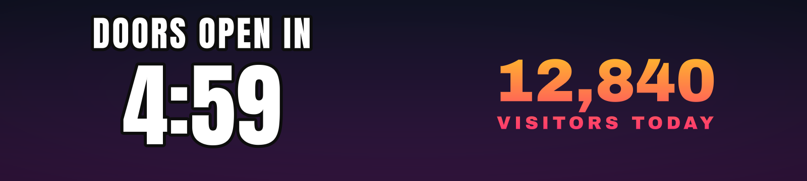</p>
<p align="center">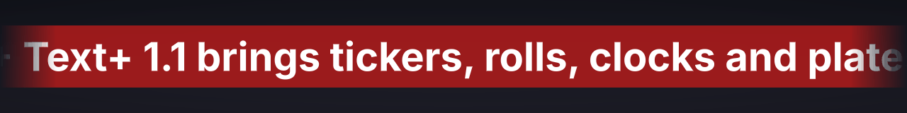</p>

**Animation** — four stackable animators
- Modes: *Sequence In / Out / In-Out* (characters, words or lines one after another), *Wave*, *Random*, *Constant*.
- Each animator moves, scales, rotates, fades, tints, **skews**, **blurs**, changes **thickness** and **spacing**, **wipes** (from left, right, centre, top or bottom) and **scrambles** (letters, digits, symbols, binary or the text's own characters); ease *Linear / Smooth / Ease In / Ease Out / Ease In-Out / Overshoot / Bounce / Elastic*; order *Forward, Reverse, From Center, From Edges, Random, Left to Right, Top to Bottom* (the last two follow the position, so they also work on paths and multi-line text).
- **Range** (*Range Start / End*, a share of the units in reading order): an animator works on a part of the text only — say the first word or the last line.
- **Target**: an animator can move the text, the plates or both — a plate wipes open, then the text follows.
- No hidden clock: everything is driven by the *Progress* slider, so you animate it the Resolume way (BPM sync, timeline, MIDI, OSC) and can always scrub. *Replay on Slide Change* plays sequences automatically when the slide changes, *Replay Stagger* starts Animator 2 a little later.
- Fading characters leave merged outlines smoothly — no holes, no popping.
- Presets: Typewriter, Fade In, Rise In, Drop In, Bounce In, Pop In, Elastic Pop, Spin In, Words Slide In, Skew In, Blur In, Tracking In, Wipe In, Decode, Fade Out, Fade In-Hold-Out, Lower Third In / Out, Wave, Weight Wave, Jitter, Glitch, Color Sweep.

<table>
<tr>
<td>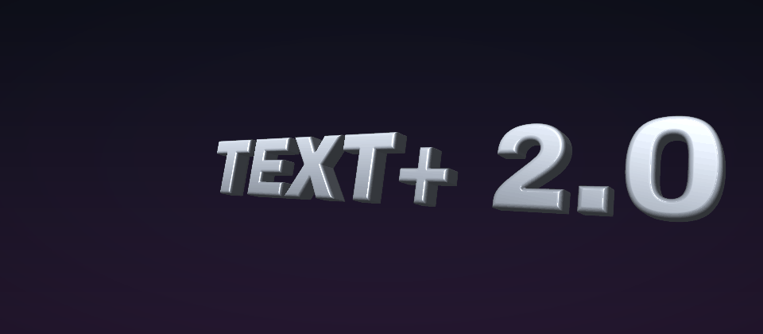</td>
<td>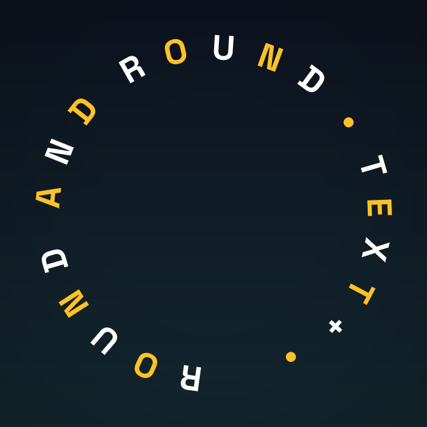</td>
</tr>
<tr>
<td>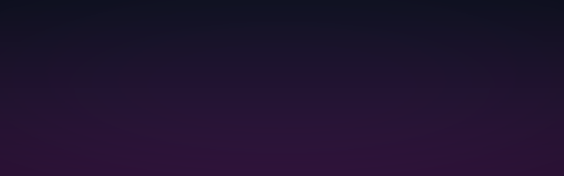</td>
<td>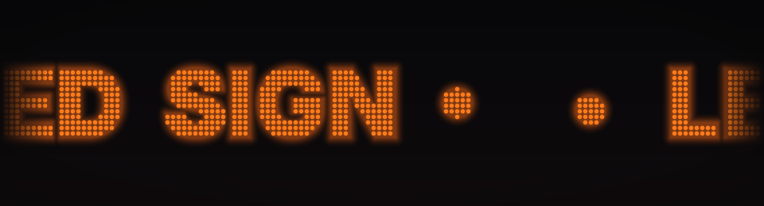</td>
</tr>
<tr>
<td>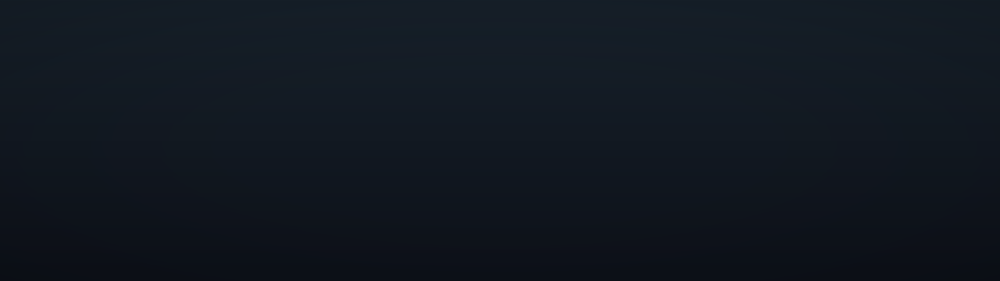</td>
<td>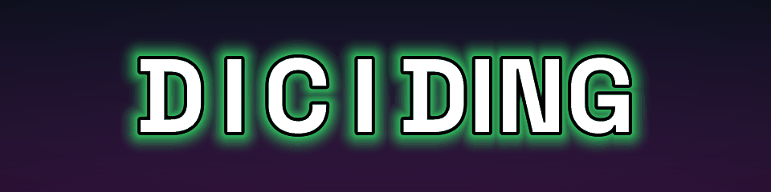</td>
</tr>
<tr>
<td></td>
<td></td>
</tr>
<tr>
<td></td>
<td></td>
</tr>
</table>

<p align="center">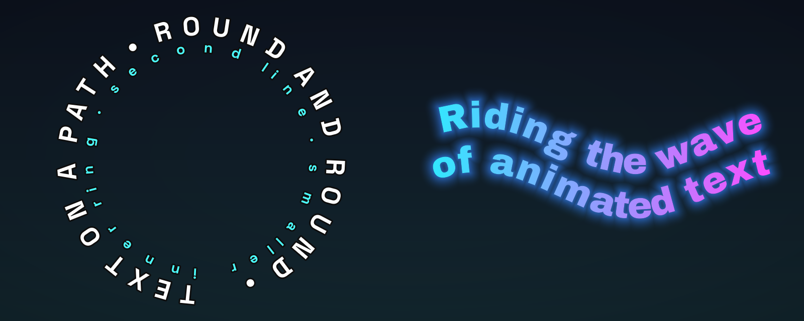</p>

**Text+ Fill** — the same plugin as an effect
- Put it on a clip or layer: *Over* draws the text over the video, *Fill Text* fills the letters with the video, *Knockout* cuts the text out of it. Outlines, plates, 3D and animation work as in the source.

<p align="center">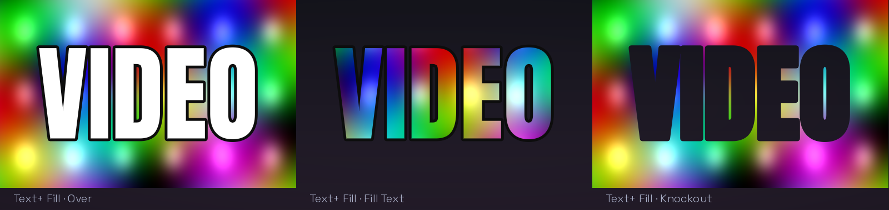</p>
<p align="center">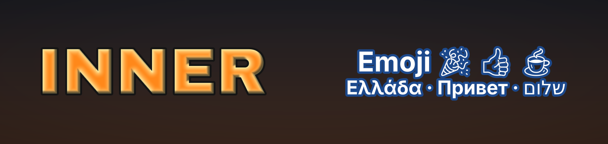</p>
<p align="center"></p>

**Performance**
- Glyphs are generated once in background threads (MSDF + true distance, 16-bit) and cached; a frame is a handful of draw calls regardless of text length, and only the bounding box is shaded.
- Shaders and scratch buffers are shared by all instances.
- 3D is drawn in a separate pass only when it is switched on. *Extrude* traces the solid per pixel and costs noticeably more GPU than flat text; it has not been measured in Arena yet.
- Tested in Arena 7.23 on a Mac (1.0): 20 instances with glow, movement and opacity animation keep a 60 fps composition at 59–60 fps.

## Installation

**macOS**
1. Download `TextPlus-<version>-macOS.zip` from the [latest release](https://github.com/floriandobler/text-plus/releases/latest) and unzip it.
2. Copy `TextPlus.bundle` and `TextPlusFill.bundle` to `~/Documents/Resolume Arena/Extra Effects` (or `Resolume Avenue`). If you use a different plugin folder, check *Preferences → Video → FFGL*.
3. The bundles are not notarised by Apple, so remove the download quarantine once in Terminal:
   ```sh
   xattr -dr com.apple.quarantine ~/Documents/"Resolume Arena"/"Extra Effects"/TextPlus*.bundle
   ```
4. Restart Resolume. **Text+** is listed under *Sources*, right next to Resolume's own text sources, **Text+ Fill** under *Effects*.

Requires macOS 11 or later and Resolume Arena / Avenue 7 (developed and tested with 7.23).

**Windows (new, not yet tested in Resolume)** — the DLL builds and passes the automated tests in a software OpenGL renderer, but nobody has run it in Resolume on Windows yet. Reports are very welcome.
1. Download `TextPlus-<version>-Windows.zip` and unzip it.
2. Copy `TextPlus.dll` and `TextPlusFill.dll` to `Documents\Resolume Arena\Extra Effects` (or Resolume Avenue).
3. Restart Resolume.

**How an animator works.** It describes where a unit is when it is "away": offset, scale, rotation, opacity, colour, how much of it is wiped away, how likely it shows a random character. *Sequence In* brings units from away to rest one after another as *Progress* goes 0 → 1; *Spread* is how many units move at once (0 = hard typewriter steps). *Sequence In/Out* brings them in, keeps them at rest for the *Hold* share and takes them out again. For *Wave*, *Progress* is the phase and *Spread* the wavelength; for *Random*, *Progress* runs through a loop of *Spread* random states. Animators add up. *+ Property* adds a property row to an animator; *Show All* and *Hide Unused* tidy up.

**Clock & timer placeholders.** `{timer}` is the value of the *Timer Mode*, `{time}` the current time (HH:MM), `{date}` today's date (DD.MM.YYYY). Text without a placeholder shows the timer alone. Countdowns and the stopwatch run in real time; *Start with Clip* restarts them when the clip is triggered. A countdown shows 0:01 until the time is really over.

**Compositions from 1.x** open with the matching settings: in 1.0 *Slides* becomes *Display* and a text file sets *Source* to File; from 1.x the new switch rows (Outline, Shadow, Glow) are set from the old values, and animators show the properties they use. All 1.1 test scenes render pixel-identical in 2.0.

## Building from source

macOS (Xcode Command Line Tools, CMake ≥ 3.20):

```sh
./scripts/build_mac.sh --install
```

The script fetches the dependencies, builds universal `TextPlus.bundle` and `TextPlusFill.bundle`, signs them ad hoc and copies them to Resolume's *Extra Effects* folder.

Windows (Visual Studio 2022, CMake ≥ 3.20): `cmake -S . -B build -A x64 && cmake --build build --config Release` gives `build/TextPlus.dll` and `build/TextPlusFill.dll`.

Linux (development only): `./scripts/run_tests_linux.sh` builds everything with a headless test host, runs the unit tests and renders test scenes with Mesa in an OpenGL 4.1 core context — checking for GL state leaks, host quirks and random parameter combinations. `tools/make_showcase.py` renders the images in this README.

## Roadmap

- **2.x**: right-to-left text, motion blur, a glyph cache on disk, more looks.
- **Later**: further plugins on the same kits (shapes, logos, QR codes, test patterns).

Ideas and bug reports are welcome in the [issues](https://github.com/floriandobler/text-plus/issues).

## Licence

Text+ is released under the [MIT licence](LICENSE). It links statically against the FFGL SDK (BSD-style), FreeType (FreeType Licence), HarfBuzz (MIT) and msdfgen (MIT) and contains the Noto Emoji font (SIL Open Font Licence) — see [THIRD_PARTY_NOTICES.md](THIRD_PARTY_NOTICES.md). Resolume, Arena and Avenue are trademarks of Resolume B.V.; Text+ is an independent project.

The fonts in the example images are Inter, Anton, Bebas Neue, Archivo Black, Space Grotesk and Righteous (SIL Open Font Licence); they are not part of Text+.

<a href='https://ko-fi.com/L7O628RVN6' target='_blank'></a>
