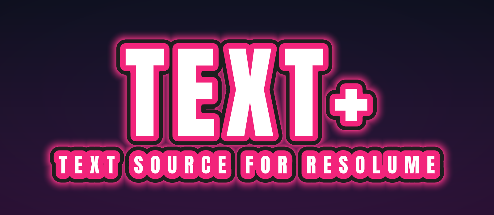
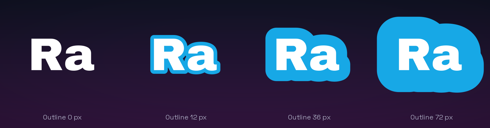
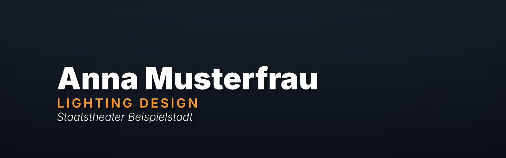
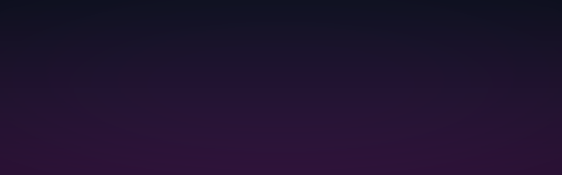
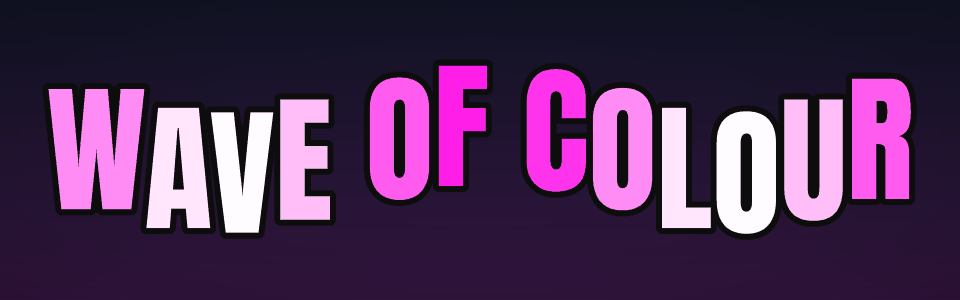
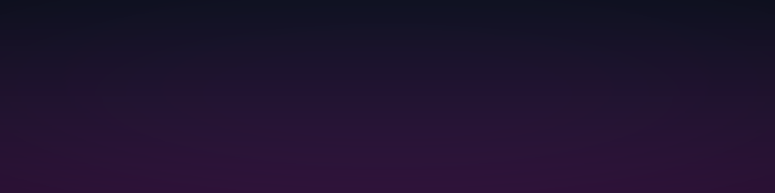
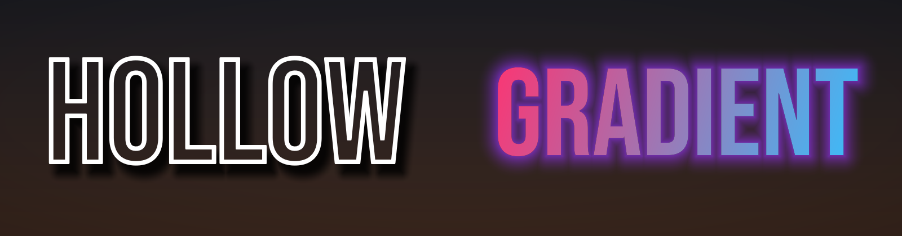
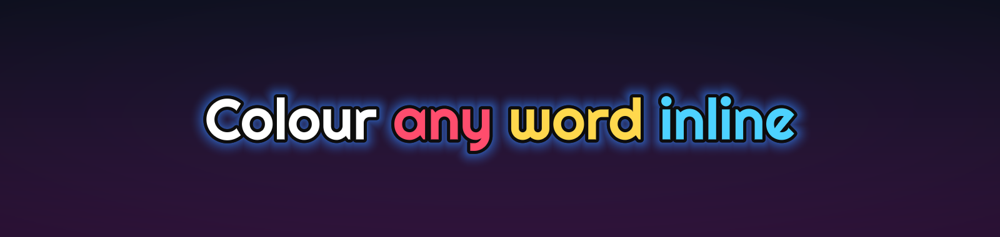

<p align="center"></p>

# Text+

**A text source for Resolume Arena and Avenue that does what the built-in Text Block and Text Animator can't.**

Text+ renders type through a signed distance field. Every effect — outlines, glow, shadow — is computed from the exact distance to the letter's edge. So an outline **grows outward only** and never eats into the letters, thick outlines of neighbouring letters **merge into one clean contour**, and everything stays **crisp at any size**. On top of that come per-character animation, slides from text or CSV files, and individually styled lines for lower thirds.

[**Download for macOS**](https://github.com/floriandobler/text-plus/releases/latest) · Resolume Arena / Avenue 7 · FFGL 2 · Apple Silicon + Intel · MIT licence

---

## Why

Resolume's own text sources grow outlines in both directions, so a thick outline eats the letter ([forum thread](https://resolume.com/forum/viewtopic.php?t=22864)). Overlapping letters get visible seams, alignment and anchors behave unexpectedly, and animation is limited to a few presets. Text+ is built around a different rendering model to fix exactly that:

<p align="center"></p>

## Features

**Typography**
- Any installed font (Family / Style menus, or type a name such as `din bold`), or load a `.ttf` / `.otf` / `.ttc` file directly. Variable fonts appear with their named styles.
- Real shaping with HarfBuzz: kerning, ligatures, accents, non-Latin scripts.
- Tracking, leading, left / centre / right / justified alignment, anchor independent of alignment, wrapping in a box with auto-fit (shrink to box, fit width).
- The chosen font is stored by name, so compositions open with the right font even after fonts were installed or removed.

**Look**
- Fill: solid, gradient across the block, or gradient across the characters. Fill alpha 0 gives hollow text.
- Two outline bands (outside, centred or inside), round or sharp corners.
- Shadow with distance, angle, softness and spread; glow with radius and strength — no blur passes, no halo artefacts.
- Inline colours: `{#ff4d6d}word{/}`.

**Line styles** — perfect for lower thirds
- *Line 2* and *Line 3+* can each have their own weight or font, size, colour, tracking and spacing. Outlines, glow and animation stay shared, so contours still merge.
- Works the same for typed lines, `|`-separated lines, text files and CSV columns.

<p align="center"></p>

**Content**
- Resolume's text fields are single-line, so Text+ adds up to nine more fields (*+ Line*), treats `|` as a line break, and reads text files that reload as soon as you save them.
- **Slides**: one line per slide, or blocks separated by an empty line or `||`. The *Slide* slider is a 0–1 position split evenly across all slides — animate it with Resolume's BPM sync and it steps through every slide and wraps around. *Next / Previous* buttons (and Resolume's −/+ next to the slider) step one slide.
- **CSV**: every row is a slide, every cell a line. `Name;Role` from a spreadsheet becomes a set of styled lower thirds. Delimiter (`;` `,` tab) and encoding (UTF-8 or Excel's Windows-1252) are detected.

**Animation** — two stackable animators
- Modes: *Sequence In / Out* (characters, words or lines one after another), *Wave*, *Random*, *Constant*.
- Each animator moves, scales, rotates, fades and tints; ease *Linear / Smooth / Ease Out / Overshoot*; order *Forward, Reverse, From Center, From Edges, Random*.
- No hidden clock: everything is driven by the *Progress* slider, so you animate it the Resolume way (BPM sync, timeline, MIDI, OSC) and can always scrub. *Replay on Slide Change* plays sequences automatically when the slide changes.
- Fading characters leave merged outlines smoothly — no holes, no popping.
- Presets: Typewriter, Fade In, Rise In, Drop In, Pop In, Spin In, Words Slide In, Fade Out, Wave, Jitter, Color Sweep.

<table>
<tr>
<td></td>
<td></td>
</tr>
<tr>
<td></td>
<td></td>
</tr>
</table>

<p align="center"></p>
<p align="center"></p>

**Performance**
- Glyphs are generated once in background threads (MSDF + true distance, 16-bit) and cached; a frame is a handful of draw calls regardless of text length, and only the text's bounding box is shaded.
- Shaders and scratch buffers are shared by all instances.
- Tested in Arena 7.23 on a Mac: 20 instances with glow, movement and opacity animation keep a 60 fps composition at 59–60 fps.

## Installation (macOS)

1. Download `TextPlus-<version>-macOS.zip` from the [latest release](https://github.com/floriandobler/text-plus/releases/latest) and unzip it.
2. Copy `TextPlus.bundle` to `~/Documents/Resolume Arena/Extra Effects` (or `Resolume Avenue`). If you use a different plugin folder, check *Preferences → Video → FFGL*.
3. The bundle is not notarised by Apple, so remove the download quarantine once in Terminal:
   ```sh
   xattr -dr com.apple.quarantine ~/Documents/"Resolume Arena"/"Extra Effects"/TextPlus.bundle
   ```
4. Restart Resolume. **Text+** is listed under *Sources*, right next to Resolume's own text sources.

Requires macOS 11 or later and Resolume Arena / Avenue 7 (developed and tested with 7.23). Windows support is prepared in the code but not built or tested yet.

## Quick start

| You want | Do this |
| --- | --- |
| A big outlined title | *Size* 200, *Outline Width* 30, *Outline 2 Width* 12, *Glow Radius* 40 |
| A lower third | *Text* = name, *+ Line*, *Text 2* = role; *Line 2 → L2 Style* = Own, *L2 Size* 45 %, *L2 Color* (alpha 1); *Align* Left |
| Lower thirds from a spreadsheet | Export `Name;Role` as CSV, choose it as *Text File*, style *Line 2*; step with *Next Slide* or BPM-sync *Slide* |
| Song lyrics on the beat | *Slides* = Each Line, put one line per row in a text file, BPM-sync *Slide* over the song section |
| Typewriter on every slide | *A1 Preset* = Typewriter, *Replay on Slide Change* = 2 (beats) |
| A looping wave | *A1 Preset* = Wave, animate *A1 Progress* 0 → 1 with BPM sync (loop) |

## Parameters

Resolume shows the internal parameter names; groups appear in this order.

| Group | Parameters |
| --- | --- |
| **Text** | *Text*, *Text 2 … Text 10* (revealed with *+ Line* / *− Line*), *Text File* (.txt, .md, .csv, .tsv), *Slides* (Off / Each Line / Blocks), *Slide* (0–1), *Next Slide*, *Previous Slide*, *Replay on Slide Change* (beats, 0 = off) |
| **Font** | *Family*, *Style*, *Size* (px), *Font* (stored name, typeable), *Font File* |
| **Line 2**, **Line 3+** | *Style* (Same as above / Own), *Weight* (styles of the main family), *Font* (empty = main font, `Bold` = a style of the main family, `Family / Style` = another font), *Size* (% of main size), *Color* (alpha = how strongly it replaces the fill), *Tracking* (added to the main tracking), *Spacing* (extra space above, % of main size) |
| **Layout** | *Position X / Y* (px from the centre, Y up), *Rotation*, *Align*, *Anchor H*, *Anchor V*, *Wrap* (Off / Box), *Box Width*, *Box Height*, *Auto Fit*, *Tracking* (1/1000 em), *Leading* (%) |
| **Fill** | *Fill Mode* (Solid / Gradient Block / Gradient Characters), *Fill Color*, *Fill Color 2*, *Gradient Angle* |
| **Outline** | *Outline Width*, *Outline Position* (Outside / Center / Inside), *Outline Corners* (Round / Sharp), *Outline Color*, *Outline 2 Width*, *Outline 2 Color* |
| **Shadow** | *Color*, *Distance* (0 = off), *Angle*, *Softness*, *Spread* |
| **Glow** | *Color*, *Radius* (0 = off), *Strength* |
| **Animator 1**, **Animator 2** | *Preset*, *Mode*, *Unit* (Character / Word / Line), *Order*, *Progress*, *Spread*, *Ease*, *Offset X / Y*, *Scale*, *Rotation*, *Opacity*, *Color* (alpha = amount) |
| **Options** | *\| = New Line*, *Color Tags*, *CSV: Skip First Row*, *Kerning*, *Ligatures*, *Edge Softness* |

**How an animator works.** It describes where a unit is when it is "away": offset, scale, rotation, opacity, colour. *Sequence In* brings units from away to rest one after another as *Progress* goes 0 → 1; *Spread* is how many units move at once (0 = hard typewriter steps). For *Wave*, *Progress* is the phase (0 → 1 is one cycle, loops seamlessly) and *Spread* the wavelength; for *Random*, *Progress* runs through a loop of *Spread* random states. Two animators add up.

## How it works

```
src/core/      platform-neutral text engine (no FFGL, no OpenGL)
  FontDatabase   font discovery (CoreText on macOS) + FreeType scan, cached on disk
  TextLayout     HarfBuzz shaping, line styles, wrapping, alignment, anchors, auto-fit
  GlyphCache     MTSDF generation with msdfgen in worker threads
  Animator       per-glyph state as a pure function of the parameters
  Csv, Utf8      CSV parsing, encodings, inline colour tags
src/render/    OpenGL 4.1 core
  GlyphAtlas     16-bit float atlas, grows on demand
  TextRenderer   field passes: distance field of the union of all glyphs (depth test keeps
                 the nearest); when opacities differ, up to 4 glyphs per pixel
                 along the opacity order (depth peeling). Composite: fill, outlines, shadow, glow, with opacity
                 integrated as a threshold so fading glyphs leave merged outlines smoothly.
src/plugin/    FFGL adapter: parameters, presets, slides, dynamic menus, host quirks
tests/         unit tests, headless FFGL host (Linux/EGL), randomised parameter test
```

## Building from source

macOS (Xcode Command Line Tools, CMake ≥ 3.20):

```sh
./scripts/build_mac.sh --install
```

The script fetches the dependencies, builds a universal `TextPlus.bundle`, signs it ad hoc and copies it to Resolume's *Extra Effects* folder.

Linux (development only): `./scripts/run_tests_linux.sh` builds the core, the plugin and a headless test host, runs the unit tests and renders test scenes with Mesa in an OpenGL 4.1 core context — checking for GL state leaks, host quirks and random parameter combinations. `tools/make_showcase.py` renders the images in this README.

## Roadmap

- **Text+ Fill**: an effect variant that fills the text with the video of the clip it sits on (or uses the text as a window into it).
- Distance-field styles: bevel & emboss, inner glow, inner shadow.
- Windows build.
- Font fallback for missing characters, bidirectional text.

Ideas and bug reports are welcome in the [issues](https://github.com/floriandobler/text-plus/issues).

## Licence

Text+ is released under the [MIT licence](LICENSE). It links statically against the FFGL SDK (BSD-style), FreeType (FreeType Licence), HarfBuzz (MIT) and msdfgen (MIT) — see [THIRD_PARTY_NOTICES.md](THIRD_PARTY_NOTICES.md). Resolume, Arena and Avenue are trademarks of Resolume B.V.; Text+ is an independent project.

The fonts in the example images are Inter, Anton, Bebas Neue, Archivo Black, Space Grotesk and Righteous (SIL Open Font Licence); they are not part of Text+.
