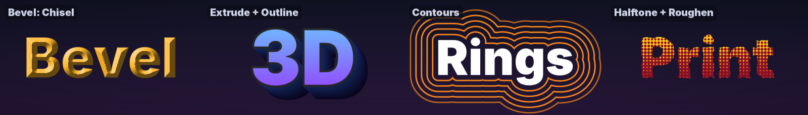
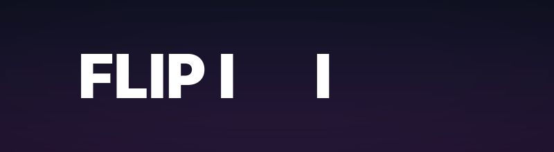
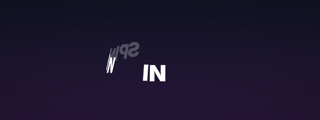
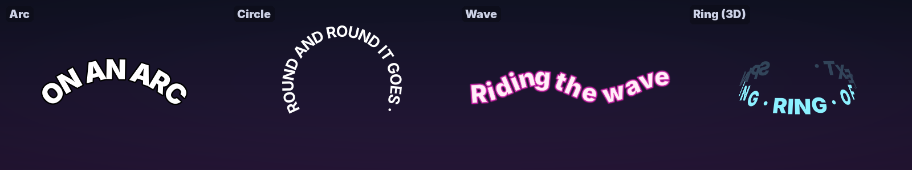
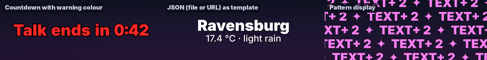
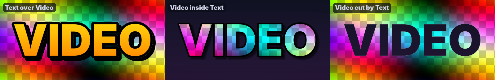

> **Note on 2.0:** the panel was reorganised: *Style* with effect slots replaces the *Fill*, *Outline*, *Shadow* and *Glow* groups, and animators show only the properties you add. Compositions from 1.x open with the same look, but please check them before a show.

<p align="center"></p>

# Text+

**A text source for Resolume Arena and Avenue that does what the built-in Text Block and Text Animator can't.**

Text+ renders type through a signed distance field. Every effect — outlines, glow, shadow, bevel, extrusion, plates — is computed from the exact distance to the shape's edge. So an outline **grows outward only** and never eats into the letters, thick outlines of neighbouring letters **merge into one clean contour**, and everything stays **crisp at any size**. On top of that come looks in one click, characters animated in 3D, text on paths, plates for lower thirds, clocks and countdowns, live data from OSC and the web, tickers, rolls and slides — and **Text+ FX**, the same engine as an effect on any clip.

[**Download**](https://github.com/floriandobler/text-plus/releases/latest) · Resolume Arena / Avenue 7 · FFGL 2 · macOS (Apple Silicon + Intel) · Windows x64 (not yet tested in Resolume) · MIT licence

---

## Why

Resolume's own text sources grow outlines in both directions, so a thick outline eats the letter ([forum thread](https://resolume.com/forum/viewtopic.php?t=22864)). Overlapping letters get visible seams, alignment and anchors behave unexpectedly, and animation is limited to a few presets. Text+ is built around a different rendering model to fix exactly that:

<p align="center"></p>

## Features

**Looks** — a whole style in one click, sized to your text

<p align="center"></p>

**A short panel** — 22 rows when you start (1.1: 52). Effect slots, *+ Property* and menus show only what you use; rows read "Offset X" instead of "A1 Offset X". *Placement* puts the text at the centre, an edge, a corner or a lower third for any resolution.

**Typography**
- Any installed font (Family / Style menus, or type a name such as `din bold`), or load a `.ttf` / `.otf` / `.ttc` file directly. Variable fonts appear with their named styles.
- Real shaping with HarfBuzz: kerning, ligatures, accents, non-Latin scripts.
- **Font fallback**: characters the font doesn't have come from the font the operating system would use (CoreText on macOS, DirectWrite on Windows). Emoji come from the built-in monochrome Noto Emoji, so they get outlines and glow like text.
- Tracking, leading, left / centre / right / justified alignment, anchor independent of alignment, wrapping in a box with auto-fit, **case** (`Tt` / `TT` / `tt`).
- **Weight**: any font a bit bolder or thinner, through the distance field.

**Style** — fill and up to six effect slots
- Fill: solid, gradient across the block, radial, across the characters, **stripes** or **halftone**. Fill alpha 0 gives hollow text.
- Effects: **outlines** (stacking outwards; the first one outside, centred or inside), **glows**, up to three **drop shadows**, **inner glow**, **inner shadow**, **bevel** (smooth, chisel, chrome), **extrude** (2.5D depth with shading; with a transparent end it is a long shadow), **contours** (rings around or inside the text) and **roughen** (noisy edges that loop). The order in the picture follows from the type — shadows behind, outlines outside in. No blur passes, no halo artefacts.
- **Plates** behind the block or behind every line: padding, corner radius, slant, border, equal or box width. Overlapping line plates melt into one shape, and the drop shadow is cast by plates and text together.
- Inline colours: `{#ff4d6d}word{/}`.

<p align="center"></p>
<p align="center"></p>

**Line styles** — perfect for lower thirds
- *Line 2* and *Line 3+* can each have their own weight or font, size, colour, tracking and spacing. Outlines, glow and animation stay shared, so contours still merge.

**3D and paths**
- Characters turn in 3D (*Rotation X*, *Rotation Y*), come from the depth (*Depth*) and slant (*Skew*), seen through a perspective (*Camera Distance*).
- *Path*: **arc** (bending up or down), **circle**, **wave**, or a **ring** spinning in 3D; *Offset*, *Spin* and *Phase* move the text along — BPM-sync them.

<table>
<tr>
<td></td>
<td></td>
</tr>
</table>
<p align="center"></p>

**Content** — *Source* says where the text comes from, *Display* how it is shown
- **Input**: Resolume's text fields are single-line, so Text+ adds up to nine more fields (*+ Line*) and treats `|` as a line break.
- **File**: text files that reload as soon as you save them, and **CSV**: every row is a slide, every cell a line. Delimiter and encoding (UTF-8 or Excel's Windows-1252) are detected.
- **Clock & Timer**: clock, countdown to a time of day, countdown, stopwatch, or a counter you animate like any slider. The text fields are the template: `Doors open in {timer}`, `{time} · {date}`.
- **Slides** (per line or per block): the *Slide* slider is a 0–1 position split evenly across all slides — BPM-sync it and it steps through every slide and wraps around. *Next / Previous* (and Resolume's −/+) step one slide.
- **Ticker**: an endless horizontal crawl at a constant speed in px/s, with a separator and soft edges. **Roll**: a vertical roll, once or looping, for credits.
- **Slides: Words**: one word after another — lyric videos, kinetic type. **Pattern**: rows of the text filling the screen, neighbouring rows running in opposite directions.

**Live data**
- **Placeholders** in any text: `{bpm}`, `{beat}`, `{bar}`, `{slide}`, `{slides}`, `{time}`, `{time:s}`, `{date}`, `{date:iso}`, `{weekday}`.
- **OSC**: set *Options → OSC Port* (e.g. 7010; Resolume itself uses 7000) and every address becomes a variable: `Home {/score/home} : {/score/away} Away`. All Text+ instances share them — one message from Companion, TouchOSC or QLab updates every clip.
- **Web (URL)**: JSON, CSV or text, fetched in the background. With JSON the text fields are the template (`{main.temp} °C, {weather[0].description}`); without placeholders the document's fields are listed with their paths. CSV rows become slides — a published Google Sheet is a live list of lower thirds. A JSON file works the same way.
- Countdowns turn to a **warning colour** (optionally blinking) at *Warn At*. Digits keep equal widths for clocks, web data and OSC values, so numbers don't jitter.

<p align="center"></p>

<p align="center"></p>
<p align="center"></p>

**Animation** — three stackable animators
- Modes: *Sequence In / Out / In-Out* (characters, words or lines one after another), *Wave*, *Random*, *Constant*.
- *+ / - Property* adds what an animator changes: offset, **depth**, scale, rotation, **rotation X / Y** (3D), **skew**, **tracking**, opacity, **blur**, **weight**, colour, **wipe** (from left, right, centre, top or bottom) and **scramble** (letters, digits, symbols, binary or the text's own characters). Only the rows you add are shown.
- Ease *Linear / Smooth / Ease In / Ease Out / Overshoot / Bounce / Elastic*; order *Forward, Reverse, From Center, From Edges, Random*.
- **Target**: an animator can move the text, the plates or both — a plate wipes open, then the text follows.
- No hidden clock: everything is driven by the *Progress* slider, so you animate it the Resolume way (BPM sync, timeline, MIDI, OSC) and can always scrub. *Replay on Slide Change* plays sequences automatically when the slide changes, *Replay Stagger* starts each further animator a little later.
- Fading characters leave merged outlines smoothly — no holes, no popping.
- Presets: Typewriter, Fade In, Rise In, Drop In, Pop In, Spin In, Words Slide In, Wipe In, Decode, Bounce In, Elastic Pop, Blur In, Track In, Skew In, Flip In (3D), Swing In (3D), Depth In (3D), Fade Out, Flip Out (3D), Fade In-Hold-Out, Lower Third In / Out, Wave, Weight Pulse, Jitter, Glitch, Color Sweep.

<table>
<tr>
<td></td>
<td></td>
</tr>
<tr>
<td></td>
<td></td>
</tr>
<tr>
<td></td>
<td></td>
</tr>
</table>

<p align="center"></p>
<p align="center"></p>

**Text+ FX** — the same engine as an effect: put it on any clip or layer and choose *Text over Video*, *Video inside Text* or *Video cut by Text*.

<p align="center"></p>

**Performance**
- Glyphs are generated once in background threads (MSDF + true distance, 16-bit) and cached; a frame is a handful of draw calls regardless of text length, and only the bounding box is shaded.
- Shaders and scratch buffers are shared by all instances. The composite comes in a small variant (the 1.1 feature set) and a full one that is only compiled when bevel, extrude, contours, roughen or Text+ FX are first used.
- Tested in Arena 7.23 on a Mac (1.0): 20 instances with glow, movement and opacity animation keep a 60 fps composition at 59–60 fps.

## Installation

**macOS**
1. Download `TextPlus-<version>-macOS.zip` from the [latest release](https://github.com/floriandobler/text-plus/releases/latest) and unzip it.
2. Copy `TextPlus.bundle` and `TextPlusFX.bundle` to `~/Documents/Resolume Arena/Extra Effects` (or `Resolume Avenue`). If you use a different plugin folder, check *Preferences → Video → FFGL*.
3. The bundles are not notarised by Apple, so remove the download quarantine once in Terminal:
   ```sh
   xattr -dr com.apple.quarantine ~/Documents/"Resolume Arena"/"Extra Effects"/TextPlus*.bundle
   ```
4. Restart Resolume. **Text+** is listed under *Sources*, right next to Resolume's own text sources; **Text+ FX** under *Effects*.

Requires macOS 11 or later and Resolume Arena / Avenue 7 (developed and tested with 7.23).

**Windows (new, not yet tested in Resolume)** — the DLL builds and passes the automated tests in a software OpenGL renderer, but nobody has run it in Resolume on Windows yet. Reports are very welcome.
1. Download `TextPlus-<version>-Windows.zip` and unzip it.
2. Copy `TextPlus.dll` and `TextPlusFX.dll` to `Documents\Resolume Arena\Extra Effects` (or Resolume Avenue).
3. Restart Resolume.

**How an animator works.** It describes where a unit is when it is "away": the properties you added with *+ / - Property* — offset, depth, scale, rotation, opacity, blur, colour, how much of it is wiped away, how likely it shows a random character. *Sequence In* brings units from away to rest one after another as *Progress* goes 0 → 1; *Spread* is how many units move at once (0 = hard typewriter steps). *Sequence In/Out* brings them in, keeps them at rest for the *Hold* share and takes them out again. For *Wave*, *Progress* is the phase and *Spread* the wavelength; for *Random*, *Progress* runs through a loop of *Spread* random states. Animators add up.

**Placeholders.** `{timer}` is the value of the *Timer Mode* (Clock & Timer source; text without a placeholder shows the timer alone), `{time}` the current time (HH:MM, `{time:s}` with seconds), `{date}` today's date (DD.MM.YYYY, `{date:iso}` YYYY-MM-DD), `{weekday}`, `{bpm}` / `{beat}` / `{bar}` Resolume's tempo and position, `{slide}` / `{slides}` the slide number and count, `{/address}` the last OSC value of that address, and with JSON `{path.to.value}` or `{items[0].title}`. Unknown placeholders stay as they are, so typos are visible. Countdowns and the stopwatch run in real time; *Start with Clip* restarts them when the clip is triggered. A countdown shows 0:01 until the time is really over.

**Compositions from 1.x** open with the matching settings: 1.1's outline, shadow and glow settings become effect slots (same picture), a position or anchor sets *Placement* to *Custom*; from 1.0, *Slides* becomes *Display* and a text file sets *Source* to File.

## Building from source

macOS (Xcode Command Line Tools, CMake ≥ 3.20):

```sh
./scripts/build_mac.sh --install
```

The script fetches the dependencies, builds universal `TextPlus.bundle` and `TextPlusFX.bundle`, signs them ad hoc and copies them to Resolume's *Extra Effects* folder.

Windows (Visual Studio 2022, CMake ≥ 3.20): `cmake -S . -B build -A x64 && cmake --build build --config Release` gives `build/TextPlus.dll` and `build/TextPlusFX.dll`.

Linux (development only): `./scripts/run_tests_linux.sh` builds everything with a headless test host, runs the unit tests and renders test scenes with Mesa in an OpenGL 4.1 core context — checking for GL state leaks, host quirks and random parameter combinations. `tools/make_showcase.py` and `tools/make_showcase_v2.py` render the images in this README.

## Roadmap

- **2.1**: right-to-left text; animator range selector; slide transitions (push, morph).
- **Later**: variable-font axes as sliders, odometer digits, write-on outlines, motion blur, glyph cache on disk; *Text+ 3D* with real extruded letters and lights; further plugins on the same kits (shapes, logos, QR codes, test patterns).

Ideas and bug reports are welcome in the [issues](https://github.com/floriandobler/text-plus/issues).

## Licence

Text+ is released under the [MIT licence](LICENSE). It links statically against the FFGL SDK (BSD-style), FreeType (FreeType Licence), HarfBuzz (MIT) and msdfgen (MIT) and contains the Noto Emoji font (SIL Open Font Licence) — see [THIRD_PARTY_NOTICES.md](THIRD_PARTY_NOTICES.md). Resolume, Arena and Avenue are trademarks of Resolume B.V.; Text+ is an independent project.

The fonts in the example images are Inter, Anton, Bebas Neue, Archivo Black, Space Grotesk and Righteous (SIL Open Font Licence); they are not part of Text+.

<a href='https://ko-fi.com/L7O628RVN6' target='_blank'></a>
